# Individual Wiki

A calm, personal wiki for collecting and finding notes. Built with Next.js,
PostgreSQL, and a custom OKLCH design system.

## What it is

Individual Wiki is a single-user workspace where you create pages, nest them
into a hierarchy, write in a block-based editor, and find your notes again
through search, favorites, and recent pages. This is the MVP: one private
workspace per account, deterministic seed data, and a full verification suite.

## Primary journey

1. **Sign in** or create an account.
2. **Create a page** from the sidebar.
3. **Write** in the block editor — content autosaves as you type.
4. **Navigate** via the page tree, favorites, or recent pages.
5. **Search** with `Cmd/Ctrl+K` to find pages by title or content.
6. **Archive** a page you no longer need and **restore** it later.

## Demo


Full-resolution recording: [docs/media/demo.webm](docs/media/demo.webm).

## Screenshots

| Sign in                               | Workspace home                                      |
| ------------------------------------- | --------------------------------------------------- |
| 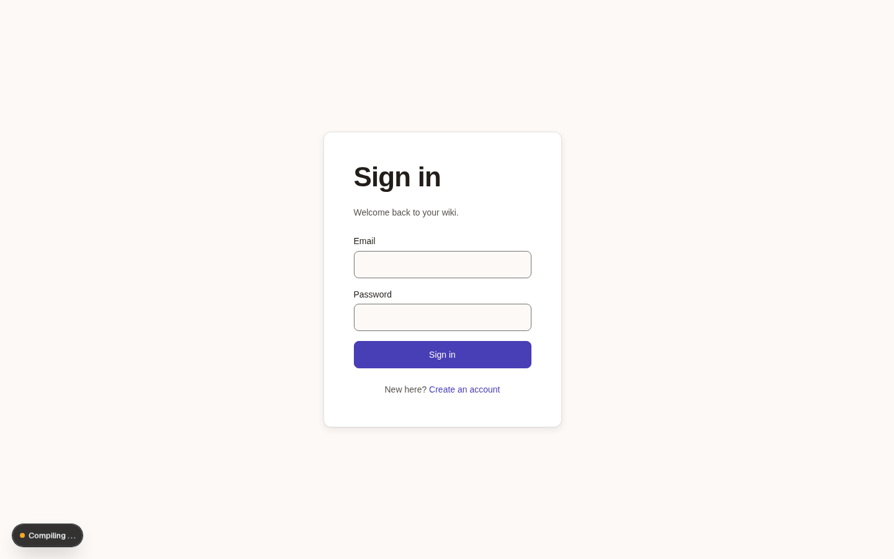 | 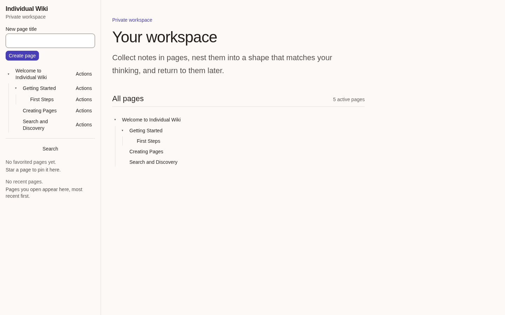 |

| Page editor                                   | Autosave                                |
| --------------------------------------------- | --------------------------------------- |
| 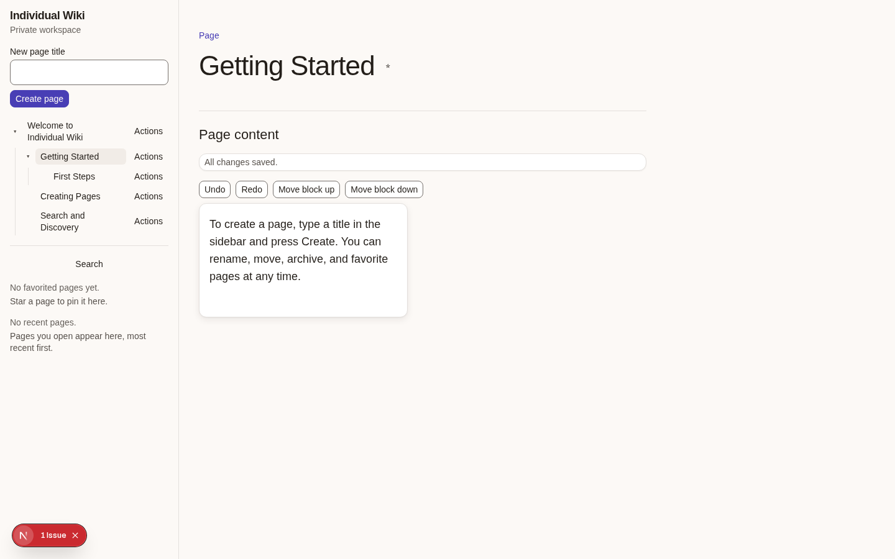 | 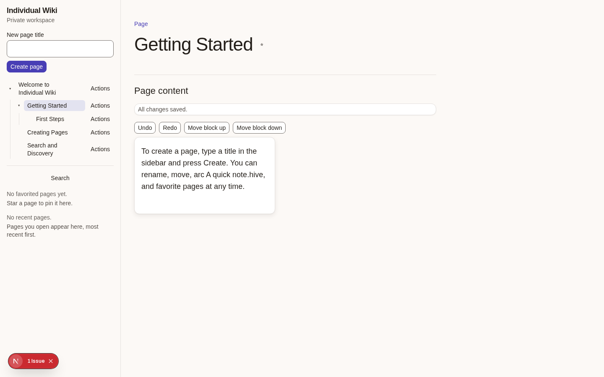 |

| Search                              | Favorite toggle                                       |
| ----------------------------------- | ----------------------------------------------------- |
| 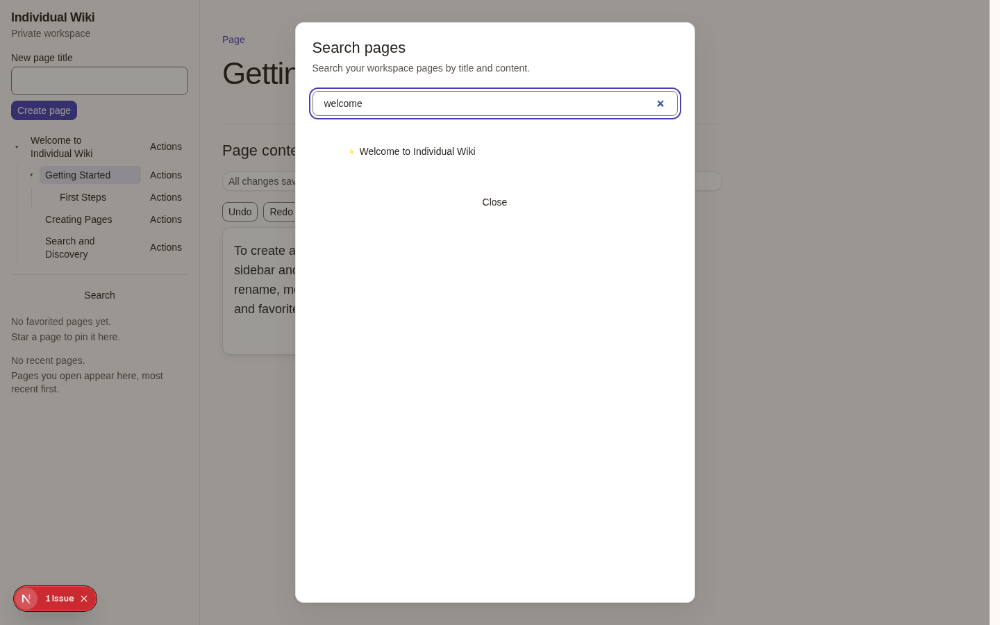 | 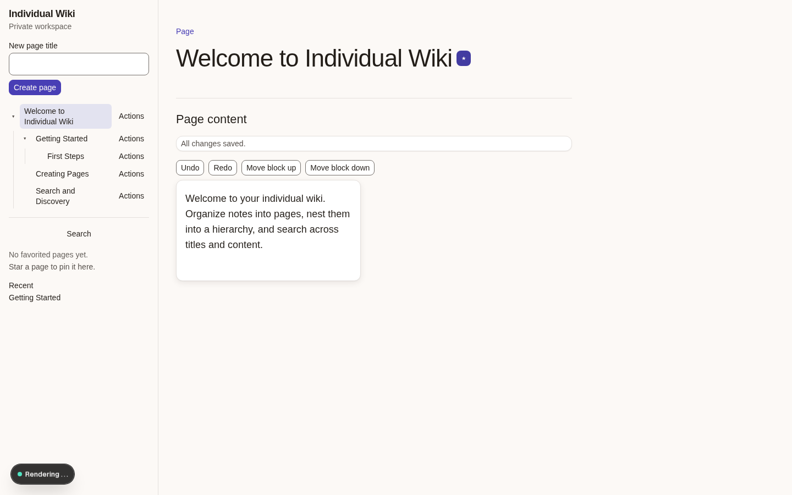 |

| Favorites & recent                                        | Archived section                                        |
| --------------------------------------------------------- | ------------------------------------------------------- |
| 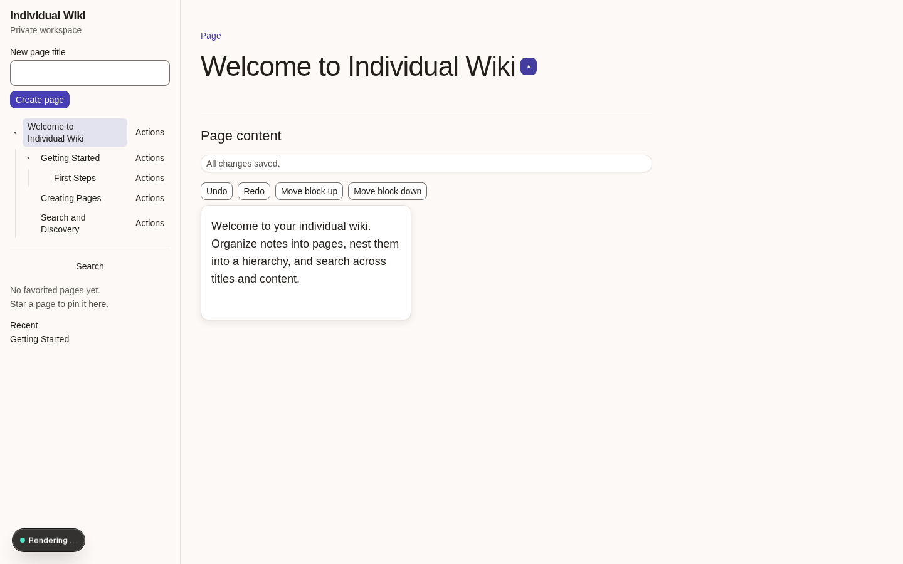 | 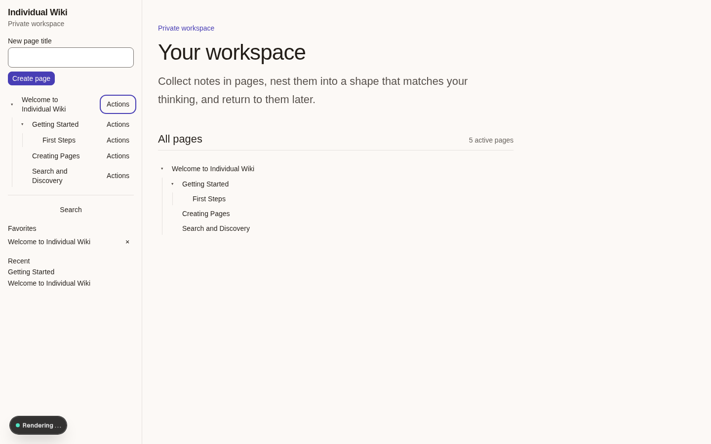 |

| Create page                                   | Narrow viewport                                       |
| --------------------------------------------- | ----------------------------------------------------- |
| 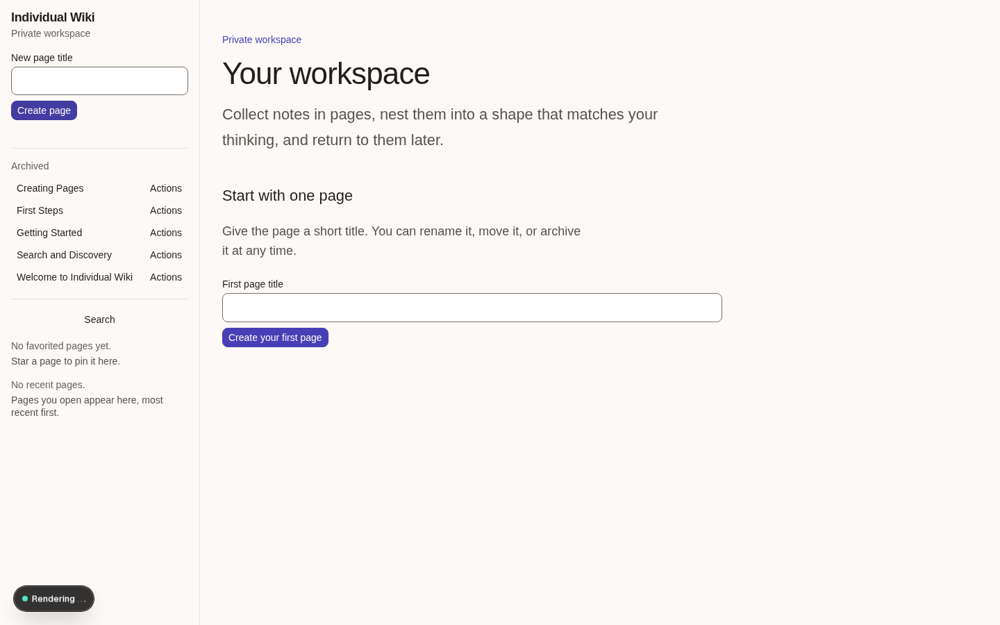 | 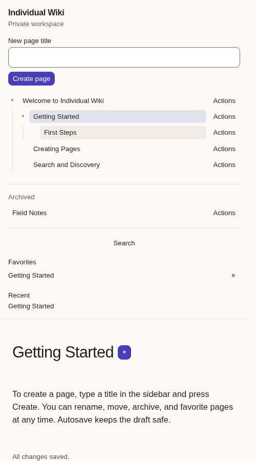 |

| Recent pages                                    | Slash menu                                  |
| ----------------------------------------------- | ------------------------------------------- |
| 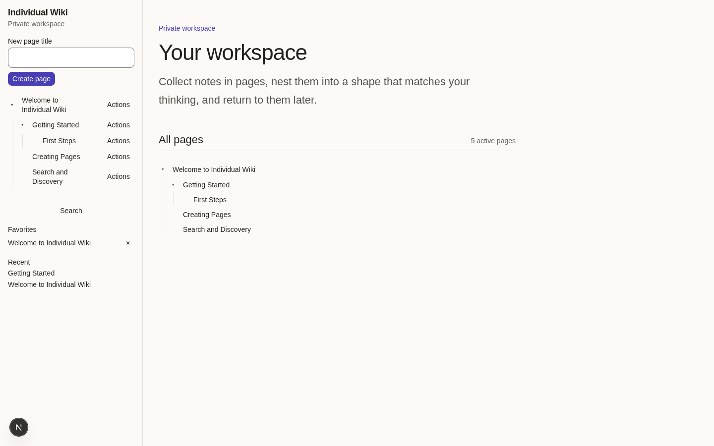 | 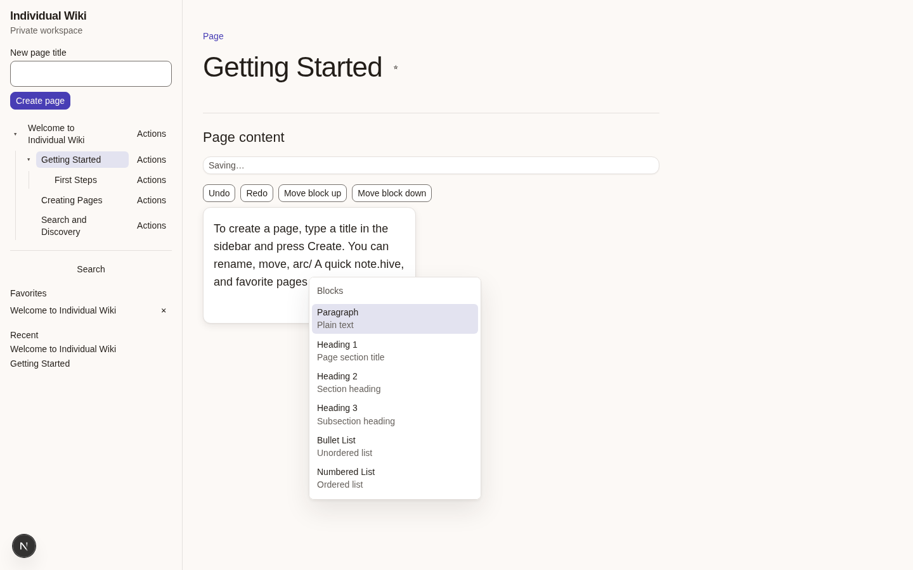 |

| Dark mode                                 |
| ----------------------------------------- |
| 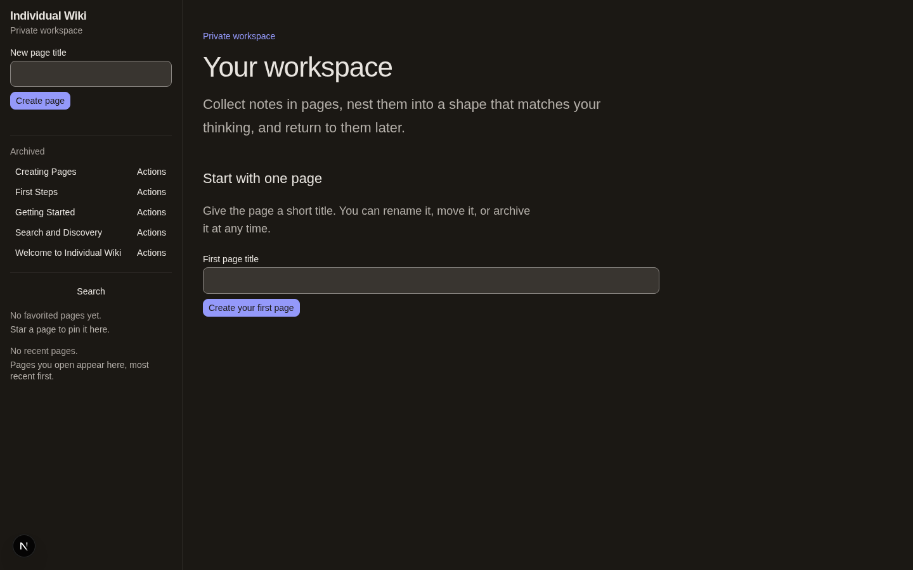 |

## Quickstart

See [docs/development/local-setup.md](docs/development/local-setup.md) for the
full fresh-checkout workflow:

```sh
pnpm install --frozen-lockfile
docker compose up -d --wait
pnpm db:migrate
pnpm db:seed
pnpm dev
```

The seeded account is `wiki@example.com` / `password1234`.

## Environment variables

| Variable             | Required | Description                                                   |
| -------------------- | -------- | ------------------------------------------------------------- |
| `DATABASE_URL`       | Yes      | PostgreSQL connection string (see `.env.example`).            |
| `BETTER_AUTH_SECRET` | Yes      | Auth signing secret; generate with `openssl rand -base64 32`. |
| `BETTER_AUTH_URL`    | Yes      | Public origin of the app (default `http://localhost:3000`).   |

Copy `.env.example` to `.env.local` and fill in the values before running.

## Stack

| Layer  | Technology                                                    |
| ------ | ------------------------------------------------------------- |
| App    | Next.js 16 (App Router), React 19, strict TypeScript          |
| Data   | PostgreSQL, Drizzle ORM, versioned SQL migrations             |
| Auth   | Better Auth (self-hosted, email/password, DB-backed sessions) |
| Editor | BlockNote 0.56.0 behind a versioned adapter                   |
| Design | Custom OKLCH token system, Radix accessible primitives        |
| Tests  | Vitest (unit/domain), Playwright (browser)                    |

## Architecture

- **Domains** (`src/server/`): `auth`, `db`, `ids`, `pages`, `workspaces`.
- **UI** (`src/components/`): `workspace`, `editor`, `ui`, `search`.
- **Routes** (`src/app/`): `(auth)` sign-in/sign-up, `(workspace)` shell + pages, `api/auth/[...all]`.
- Page metadata/hierarchy is separate from versioned editor content.
- All domain operations resolve `UserId` server-side from the session.
- UI code cannot import database clients (enforced by ESLint).

See [docs/adr/](docs/adr/) and [docs/superpowers/specs/](docs/superpowers/specs/) for design decisions.

## Verification

```sh
pnpm format:check   # formatting
pnpm lint           # ESLint
pnpm typecheck      # TypeScript
pnpm test           # unit tests (no database needed)
pnpm build          # production build
pnpm db:migrate     # apply migrations
pnpm test:db        # database-backed tests
pnpm test:e2e       # Playwright browser tests (port 3100)
pnpm verify         # full chain — needs database + port 3100
```

`pnpm verify` is the one command that runs everything in order. It requires a
running PostgreSQL database and a free port 3100.

## License

Private project. All rights reserved.
